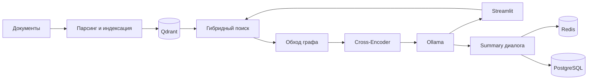

# OmniRAG — локальный поиск по документам

**RAG-система с гибридным поиском, обходом связей между фрагментами и памятью диалога.**

Python · LangChain · Qdrant · Ollama · Redis · PostgreSQL · Streamlit · Docker

Командный проект летней практики. Эта версия продолжает [Nionk/omni-rag](https://github.com/Nionk/omni-rag) и основана на ветке `feature/rag-memory-graph`. В коммите [a2c3c329](https://github.com/Nionk/omni-rag/commit/a2c3c3295e04725dd010be40c3f27481f08759ea) с авторством **Ilush1k** добавлены графовый обход и память Redis/PostgreSQL. История исходного проекта сохранена.

## Что умеет система

- Извлекать текст из PDF, DOCX, TXT, HTML и XML.
- Следить за изменениями файлов, индексировать фрагменты и хранить метаданные в Qdrant.
- Совмещать dense-поиск и разреженные BM25-представления.
- Расширять найденный контекст ограниченным BFS по связям чанков.
- Переранжировать кандидатов Cross-Encoder и передавать Top-4 локальной модели Ollama.
- Формировать потоковый ответ в Streamlit и поддерживать временные файлы сеанса.
- Сжимать диалог в summary, хранить горячую копию в Redis и архив в PostgreSQL.

## Архитектура



[Подробности архитектуры и вклада](docs/PROJECT.md).

## Материалы практики

- [Отчёт по летней практике Word](docs/practice-report.docx).
- [Презентация проекта PowerPoint](docs/project-presentation.pptx).
- [Соответствие отчёта текущему коду](docs/REPORT_CODE_MAP.md).

Материалы описывают проект и демонстрацию. В текущей ветке интерфейс Streamlit вызывает Python-модули напрямую: отдельного FastAPI REST API из отчёта здесь нет. Суммаризация выполняется последовательно. Эти различия и границы заявленных результатов перечислены в таблице соответствия.

## Запуск на CPU через Docker

Нужны Git, Docker и Docker Compose. Приведённый вариант размещает Ollama в отдельном контейнере и не требует установленной модели на хосте.

```bash
git clone https://github.com/Ilush1k/omni-rag.git
cd omni-rag
mkdir data
```

Скопируйте `examples/project-guide.txt` в папку `data/`. Это искусственный пример, пригодный для проверки без рабочих документов. При необходимости скопируйте `.env.example` в `.env` и настройте параметры.

Запустите хранилища и инференс-сервис:

```bash
docker compose -p omni-rag-demo -f docker-compose.yml -f compose.ollama.yml --profile cpu up -d qdrant redis postgres ollama
docker compose -p omni-rag-demo -f docker-compose.yml -f compose.ollama.yml --profile cpu exec ollama ollama pull qwen2.5:3b
```

Постройте индекс и запустите приложение:

```bash
docker compose -p omni-rag-demo -f docker-compose.yml -f compose.ollama.yml --profile cpu run --build --rm rag-app-cpu python -m src.cli.ingest
docker compose -p omni-rag-demo -f docker-compose.yml -f compose.ollama.yml --profile cpu up -d rag-app-cpu
```

Откройте `http://localhost:8501`. Пример вопроса: «Какая дата сдачи отчёта указана в документе?». При изменении файлов повторите индексацию. Первый запуск скачивает пакеты, модель эмбеддингов, BM25-модель, Cross-Encoder и LLM; после подготовки кэшей можно организовать локальную работу.

Остановка с сохранением хранилищ:

```bash
docker compose -p omni-rag-demo -f docker-compose.yml -f compose.ollama.yml --profile cpu down
```

## Нативная Ollama и GPU

Базовый `docker-compose.yml` использует Ollama на хосте через `host.docker.internal:11434`. На Docker Desktop такой адрес указывает на хост; сам сервис Ollama должен быть доступен контейнеру. Загрузите `qwen2.5:3b` в нативную Ollama и запускайте базовый Compose с профилем `cpu` или `gpu` без `compose.ollama.yml`.

Профиль `gpu` дополнительно требует NVIDIA Container Toolkit и доступной видеокарты для контейнера приложения. Полный GPU-запуск при оформлении не проверялся. Overlay `compose.ollama.yml` по умолчанию запускает CPU-инференс Ollama; он не добавляет GPU автоматически.

## Проверка без загрузки нейросетей

Python 3.11+:

```bash
python -m venv .venv
# Активируйте .venv для своей оболочки
python -m pip install -r requirements-test.txt
python -m pytest -q
```

Для интеграционной проверки памяти в отдельных временных Redis и PostgreSQL:

```bash
docker compose -p omni-rag-check -f compose.tests.yml run --build --rm tests
docker compose -p omni-rag-check -f compose.tests.yml down
```

Тесты проверяют ограничение BFS, циклы, сбои хранилищ, разделение памяти пользователей, восстановление архива и суммаризацию с заменой LLM тестовым объектом. Полный прогон парсинга, индексации и генерации на скачанных моделях — отдельная проверка и не выполнялся при оформлении портфолио.

Результат изолированной проверки: **13 тестов прошли**. [Условия и границы проверки](docs/VALIDATION.md).

## Ограничения

Нулевая температура и инструкция использовать источники не гарантируют отсутствие ошибок LLM. Локальный инференс сам по себе не доказывает абсолютную конфиденциальность. В интерфейсе ID пользователя не заменяет аутентификацию. Заявления об улучшении качества поиска требуют отдельной размеченной выборки и воспроизводимой оценки.

В репозитории нет рабочих документов, индексов, истории диалогов и приватного `.env`. Документы практики сохранены как исходные авторские материалы с пояснением соответствия реализации.
